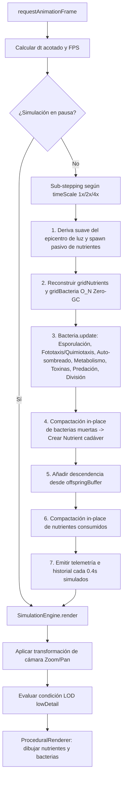

# Arquitectura del Proyecto y Decisiones de Diseño — EvoLootIon

Este documento describe la organización modular del código fuente de **EvoLootIon**, el flujo de ejecución del bucle de simulación y las decisiones arquitectónicas adoptadas tras la revisión técnica.

---

## 1. Estructura del Proyecto

El proyecto está construido como una aplicación web *Single Page Application* (SPA) utilizando **Vite** y **TypeScript** en modo estricto (`strict: true`), sin dependencias pesadas en tiempo de ejecución para maximizar el rendimiento en PC y dispositivos móviles.

```text
EvoLootIon/
├── index.html                        # Maquetación responsive (Sidebar + Viewport + Inspector + HUD)
├── package.json                      # Scripts de construcción y dependencias de desarrollo (Vite, TS)
├── tsconfig.json                     # Configuración estricta de TypeScript (ES2022, bundler)
├── MECANICAS_JUEGO.md                # Documentación funcional y modelo matemático
├── ARQUITECTURA.md                   # Documentación técnica y decisiones de diseño (ADRs)
├── DESARROLLO_Y_DESPLIEGUE.md        # Guía de compilación, pruebas y puesta en producción
├── AGENTS.md                         # Contexto e invariantes para agentes de IA / LLMs
└── src/
    ├── main.ts                       # Punto de entrada: enlaza DOM, cámara táctil/ratón y telemetría
    ├── config/
    │   └── SimulationConfig.ts       # Constantes físicas, biológicas y umbrales de rendimiento (SSoT)
    ├── core/
    │   ├── SpatialHashGrid.ts        # Estructura de partición espacial 2D O(1) con estrategia Zero-GC
    │   └── SimulationEngine.ts       # Bucle principal (sub-stepping, física, compactación y cámara)
    ├── models/
    │   ├── DNA.ts                    # Genotipo: 5 categorías, stats, trade-offs y operador de mutación
    │   ├── Bacteria.ts               # Fenotipo: estado vital, quimiotaxis, combate y reproducción
    │   └── Nutrient.ts               # Sustrato mineral y detritus orgánico (cadáveres)
    ├── i18n/
    │   └── i18n.ts                   # Internacionalización (ES/EN extensible) y adaptación por edades (5-7 a 15+)
    └── render/
        └── ProceduralRenderer.ts     # Renderizado vectorial procedural en Canvas 2D y soporte LOD
```

---

## 2. Flujo de Ejecución por Fotograma (Tick)

El ciclo de vida en `SimulationEngine.loop()` sigue un esquema desacoplado entre simulación matemática y presentación visual:



---

## 3. Decisiones de Arquitectura (ADRs)

### ADR-01: Separación Estricta entre Modelo Matemático y Renderizado (SRP)

* **Contexto:** En el prototipo inicial, `Bacteria` y `Nutrient` contenían métodos `render(ctx)` con llamadas directas a la API del DOM (`CanvasRenderingContext2D`).
* **Decisión:** Extraer toda la geometría y dibujo vectorial a métodos estáticos en `src/render/ProceduralRenderer.ts`. Las clases en `src/models/` contienen exclusivamente estado numérico y lógica biológica.
* **Consecuencias:**
  * Se cumple el Principio de Responsabilidad Única (SRP).
  * El método `ProceduralRenderer.renderBacteria()` se utiliza en el lienzo principal del ecosistema y `ProceduralRenderer.renderMicroscopePreview()` proporciona una vista ampliada de alta definición sobre retícula de microscopio electrónico en el **Editor Genómico y Fenotípico** previo al inicio de la simulación.
  * El motor (`src/models/` + `src/core/SpatialHashGrid.ts`) queda listo para trasladarse a un **Web Worker** en segundo plano o ejecutarse en modo *headless* para pruebas automatizadas sin depender de `window` ni `HTMLCanvasElement`.

### ADR-02: Partición Espacial O(1) con Estrategia Zero-GC

* **Contexto:** Consultar vecinos por fuerza bruta supone un coste $O(N^2)$ entre bacterias y $O(N \times M)$ con nutrientes. Además, una implementación ingenua de `SpatialHashGrid` que haga `this.grid.clear()` y devuelva un nuevo `results = []` en cada `queryRadius()` genera decenas de miles de arrays efímeros por segundo a 60 FPS, provocando pausas del *Garbage Collector* (*frame drops*) en navegadores móviles.
* **Decisión:**
  1. `SpatialHashGrid.clear()` recorre las celdas existentes y ejecuta `cell.length = 0`, conservando las instancias de `Array` ya reservadas en el *heap*.
  2. `SpatialHashGrid.queryRadius(x, y, r, out)` vacía y rellena un buffer de salida preasignado (`out.length = 0`).
  3. En `Bacteria` se mantienen tres buffers estáticos independientes (`neighborNutrientsBuf`, `contactNutrientsBuf` y `neighborBacteriaBuf`) para evitar que una consulta de contacto sobrescriba accidentalmente el buffer de percepción dentro del mismo tick.
* **Consecuencias:** Complejidad de consulta reducida a $O(1)$ amortizado con **cero asignaciones de memoria por consulta** una vez estabilizadas las celdas del mapa.

### ADR-03: Compactación In-Place de Entidades Muertas

* **Contexto:** Eliminar bacterias muertas con `Array.splice(i, 1)` dentro de un bucle cuesta $O(N^2)$ por desplazamiento de elementos, mientras que usar `this.nutrients = this.nutrients.filter(...)` instancia un array completo nuevo en cada fotograma.
* **Decisión:** Utilizar compactación *in-place* mediante doble índice (`writeB` y `writeN`) en `SimulationEngine.update()`, truncando al final la longitud (`this.bacteria.length = writeB`) y reutilizando un único `offspringBuffer` preasignado para los nacimientos.
* **Consecuencias:** Eliminación en tiempo $O(N)$ lineal estricto y sin presión sobre el recolector de basura.

### ADR-04: Acoplamiento Determinista de Costes Evolutivos en `DNA`

* **Contexto:** En el código preliminar, las mutaciones alteraban `maxSpeed` o `armor`, pero los costes derivados (`basalMetabolism` y `dragFactor`) estaban desincronizados o se calculaban parcialmente fuera del constructor.
* **Decisión:** Centralizar la ley alométrica de Kleiber ($\propto r^2$), el multiplicador de pared celular, el drenaje de armadura y el arrastre locomotor ($\propto r \cdot v_{\max}^{1.8}$) dentro de `DNA.recalculateDerivedCosts()`, invocado automáticamente al construir cualquier instancia de `DNA` (tanto inicial como mutada).
* **Consecuencias:** Es imposible instanciar una bacteria cuyos atributos violen las leyes termodinámicas del simulador.

### ADR-05: Sub-stepping Físico y Nivel de Detalle Dinámico (LOD)

* **Contexto:** Al acelerar la simulación (`2x`, `4x`), multiplicar directamente `dt` por 4 provoca que bacterias rápidas atraviesen nutrientes o paredes sin detectar contacto (*efecto túnel*). Por otro lado, cuando la población supera varios cientos de individuos o el usuario aleja el zoom, dibujar cilios individuales y gradientes para cada célula penaliza la GPU/CPU.
* **Decisión:**
  * En `SimulationEngine.loop()`, cuando `timeScale > 1`, el avance se divide en `steps = Math.round(timeScale)` sub-pasos físicos con `stepDt` constante.
  * `SimulationEngine.render()` activa automáticamente el modo `lowDetail` cuando `camera.zoom < 0.65`, cuando `bacteria.length > 450` o cuando el usuario lo fuerza desde el HUD. En modo `lowDetail` se omiten flagelos, cilios, halos secundarios y orgánulos internos, manteniendo intacta la lectura de forma y color de cepa.
* **Consecuencias:** La simulación mantiene la misma precisión matemática a `1x` y a `4x`, y sostiene 60 FPS fluidos en pantallas de alta densidad (`devicePixelRatio`).
